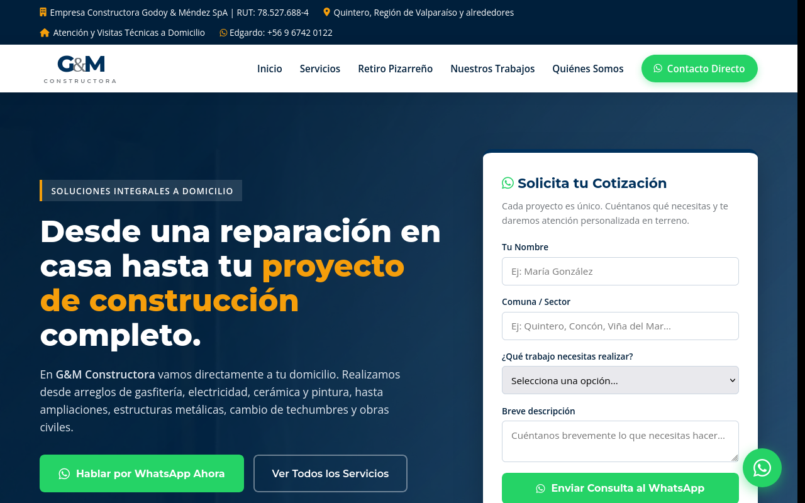
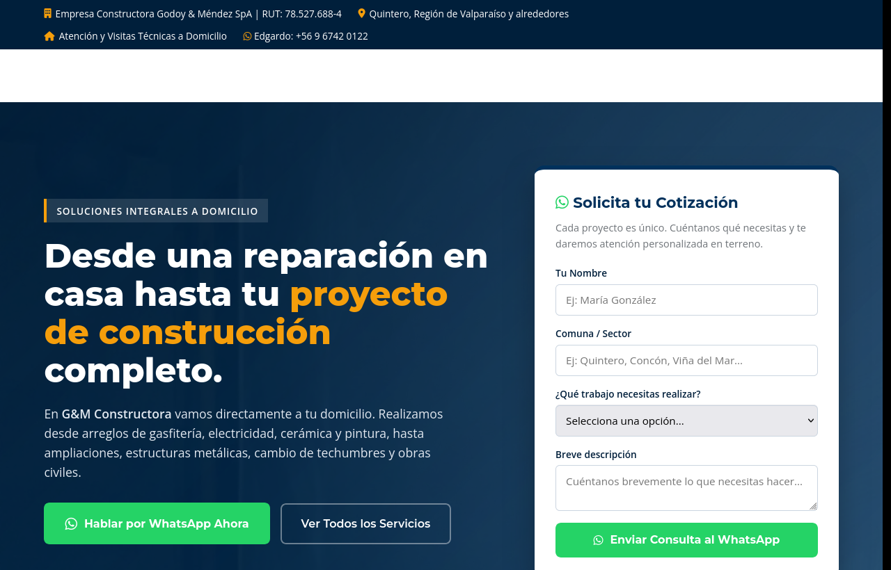
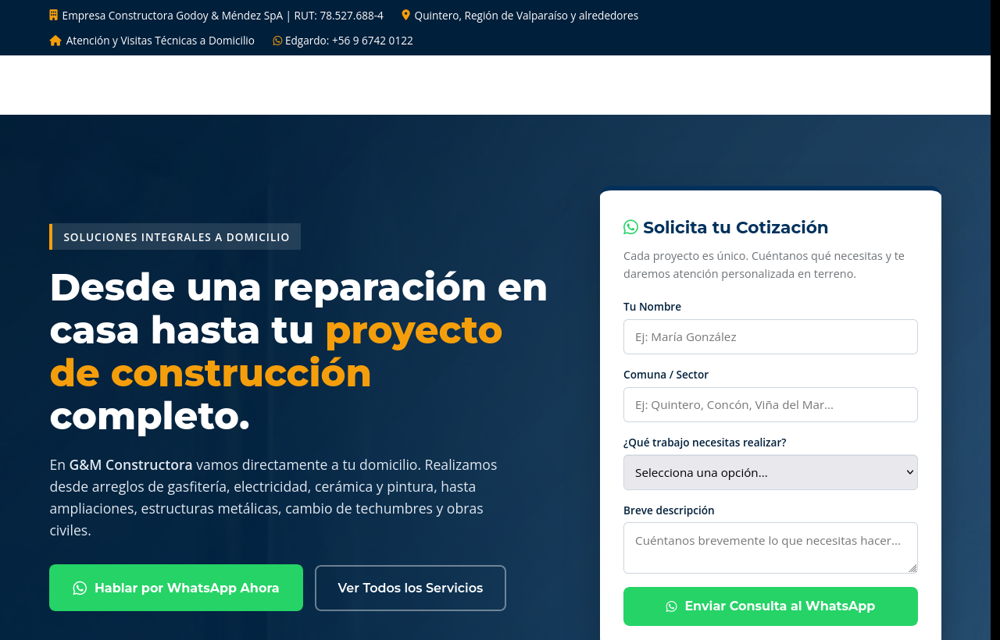
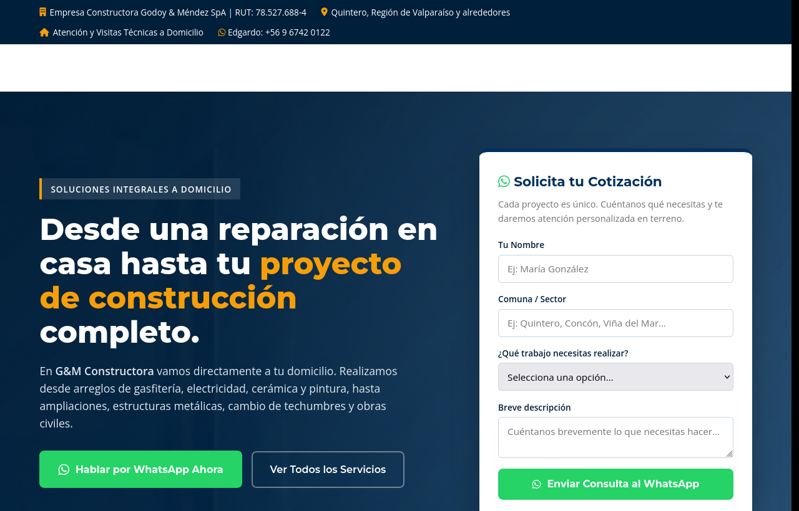
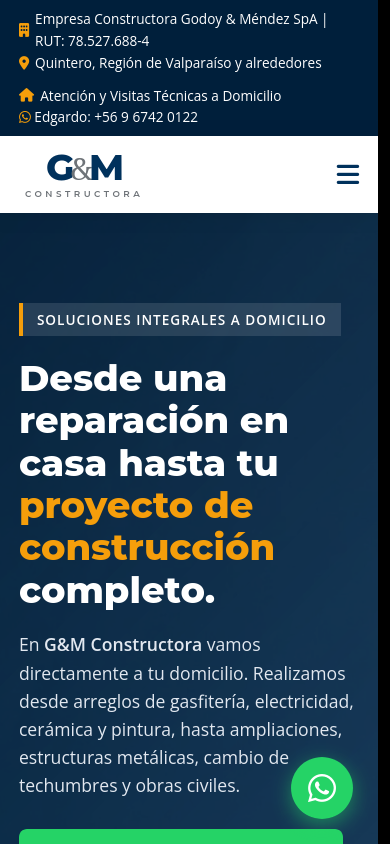

# 🏗️ G&M Constructora — Plataforma Web Corporativa

**Empresa Constructora Godoy & Méndez SpA (Quintero, Región de Valparaíso, Chile)**  
*Construcción, remodelaciones, cambio de techumbres y reparaciones integrales a domicilio.*

[🌐 Ver Sitio Web en Vivo](https://deralexsander.github.io/GMConstructora/)

---

## 📌 1. Acerca del Proyecto y Cliente

**G&M Constructora (Empresa Constructora Godoy & Méndez SpA)** es una PYME formalizada dedicada al rubro de la construcción habitacional, comercial, obras civiles y servicios técnicos a domicilio en la Región de Valparaíso (Quintero, Concón, Viña del Mar y alrededores).

Este proyecto consistió en una **consultoría digital y desarrollo full-stack integral** que abarcó:
- **Conceptualización y Levantamiento de Requerimientos:** Entrevistas y estructuración del portafolio de servicios.
- **Diseño UI/UX:** Interfaz moderna, confiable y limpia con la paleta de identidad corporativa (Azul marino `--gm-blue: #00315C`, gris y toques de seguridad).
- **Desarrollo Frontend:** Maquetación responsiva en HTML5 semántico, CSS3 moderno con variables y animaciones nativas, y JavaScript ES6+ para filtros de servicios interactivos y cotizador a WhatsApp.
- **Optimización de Activos:** Conversión y compresión a formato **WebP** de alta eficiencia para carga ultra veloz.
- **Gestión de Infraestructura:** Asesoría en adquisición de dominios web (URL), configuración DNS y despliegue a producción sobre **GitHub Pages**.

---

## 📸 2. Capturas del Sitio en Producción

### 🖥️ Portada Principal (Hero & Identidad Corporativa)
*Diseño limpio con tipografía corporativa en CSS puro, propuesta de valor y acceso directo a cotizaciones.*

  

### 🧰 Catálogo de Servicios con Filtros Interactivos
*Filtros dinámicos sin recarga entre Reparaciones, Construcción y Obras de Exterior con botones de acción directa.*

  

### 🏗️ Galería de Obras y Proyectos Reales
*Vitrina de obras documentadas en terreno: techumbres, ampliaciones, cobertizos y remodelación de baños.*

  

### 📱 Experiencia Móvil y Respaldo Corporativo
*Diseño 100% responsivo para celulares junto a la sección de equipo y datos estatutarios de la SpA.*

  
  &nbsp;
  

---

## 🛠️ 3. Especialidades y Servicios Destacados

1. **Reparaciones y Terminaciones a Domicilio:** Gasfitería, electricidad, grifería, instalación de cerámicos, porcelanato y pintura interior/exterior.
2. **Cambio de Techumbres y Retiro de Pizarreño:** Especialidad en recambio seguro de cubiertas antiguas con alto contenido de sílice por zinc y teja asfáltica.
3. **Construcción y Obras Mayores:** Ampliaciones de casas, cabañas, albañilería, radieres y carpintería general.
4. **Estructuras Metálicas y Soldadura:** Portones, rejas de seguridad, cobertizos y protecciones soldadas a medida.

---

## 🚀 4. Características Técnicas del Sitio

- **Cotizador Rápido Directo a WhatsApp:** Formulario dinámico que captura los datos del cliente, comuna y tipo de trabajo, formateando un mensaje listo para enviar al equipo técnico.
- **Filtros Interactivos de Servicios:** Clasificación instantánea sin recarga entre *Reparaciones*, *Construcción* y *Exterior*.
- **Galería de Obras Reales:** Vitrina visual con proyectos terminados documentados en terreno.
- **Rendimiento Máximo:** Sin dependencias pesadas de frameworks, 100% responsivo y optimizado para dispositivos móviles.

---

## 👨‍💻 Créditos & Desarrollo
Desarrollado y gestionado por **Nicolás Alexsander Muñoz Méndez** ([@deralexsander](https://github.com/deralexsander)).  
*Valparaíso, Chile.*
